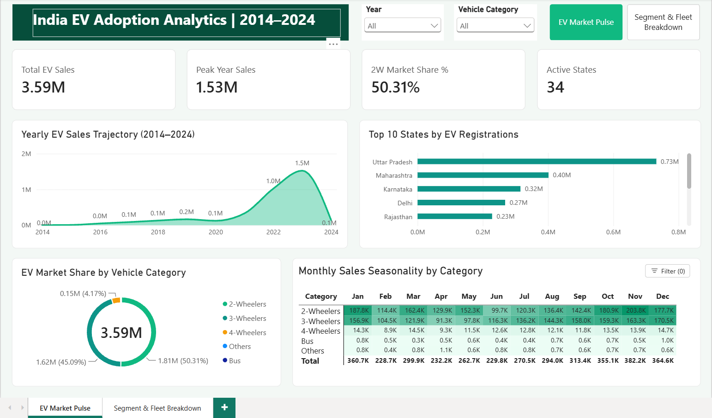
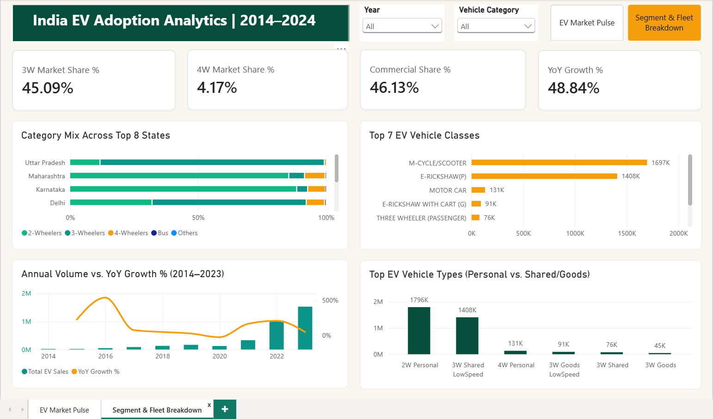

# India EV Adoption Analytics | 2014–2024 (Power BI)

An interactive two-page Power BI executive dashboard analyzing **3.59M electric vehicle registrations** across **34 Indian states and union territories (2014–2024)** to uncover adoption velocity, monthly seasonality, state-level fleet composition, and commercial vs. personal segment shifts.

## Dashboard Preview

### Page 1 — EV Market Pulse

### Page 2 — Segment & Fleet Breakdown

## Key Insights
* **Hyper-Growth Trajectory:** Total EV registrations scaled from **2.4K units (2014)** to a full-year peak of **1.53M units (2023)**—a **48.84% YoY increase** in 2023 following a **209.12%** surge in 2022 *(2024 reflects January data only at 143K units)*.
* **Two- & Three-Wheeler Dominance:** **2-Wheelers (1.81M | 50.31%)** and **3-Wheelers (1.62M | 45.09%)** drive **95.40%** of total adoption, while **4-Wheelers** account for **4.17% (0.15M)**.
* **Regional Fleet Divergence:** **Uttar Pradesh (0.73M)** leads total registrations driven overwhelmingly by commercial 3-wheelers (`E-Rickshaw (P)`), whereas **Maharashtra (0.40M)** and **Karnataka (0.32M)** are led by personal 2-wheelers (`M-Cycle/Scooter`).
* **Commercial vs. Personal Split & Q4 Surge:** **Commercial/Fleet** vehicles (`Shared`, `Goods`, `Bus`) represent **46.13%** of overall volume, with nationwide sales peaking in **Q4 (Oct–Dec)** and reaching an all-time monthly high in **November (382.2K units)**.

## Data Modeling & Technical Implementation
* **Star Schema:** Fact table (`EV_Dataset`, 96,845 records) modeled with a dedicated DAX `Calendar` dimension table (`2014–2024`) using US-locale date parsing (`M/D/YYYY`) and chronological month sorting.
* **DAX Measures (`_Measures`):** Custom KPIs built with `CALCULATE`, `DIVIDE`, `MAXX`, `SAMEPERIODLASTYEAR`, and `CONTAINSSTRING` (`Total EV Sales`, `Peak Year Sales`, `2W/3W/4W Market Share %`, `Commercial Share %`, `YoY Growth %`, and `Active States`).
* **UX & Visual Design:** Responsive `1280 × 720` layout featuring synced global slicers (`Year`, `Vehicle Category`), conditional emerald seasonality heatmap, 100% stacked regional category mix, and state-aware page navigation switching between **Growth (`#10B981`)** and **Fleet (`#F59E0B`)** accents.

## Repository Structure
* `India_EV_Adoption_Analytics.pbix` — Complete Power BI Desktop report
* `EV_Dataset.csv` — Source dataset (96,845 state-level EV registration records)
* `01_ev_market_pulse.png` / `02_segment_fleet_breakdown.png` — Dashboard exports
